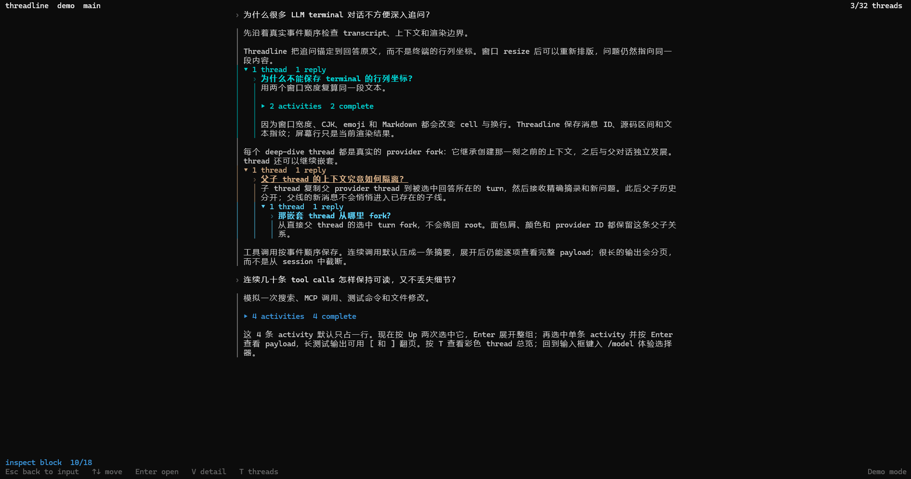
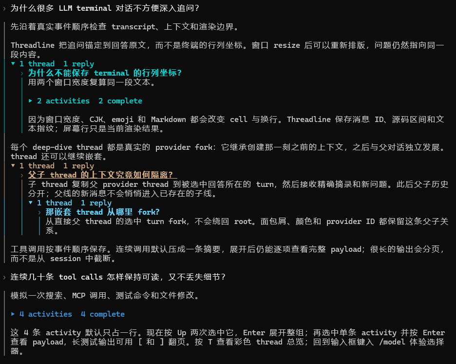
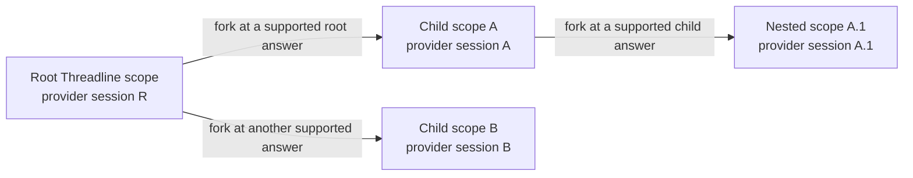

# Threadline

Threadline is a terminal UI for branching from an exact passage in an LLM CLI answer without losing the conversation that produced it. A deep dive stays visible beside its source, can contain its own tool calls, and can branch again.

Threadline supports Codex and Claude Code. It uses provider sessions for model context and a local scope tree for navigation, persistence, and rendering.

## Native Codex with terminal panels

`--terminal` keeps a collapsible conversation view on screen by default, with the real Codex input area underneath. Main questions, branch questions, source quotations, parent answers, and the latest reply have separate labels and visual hierarchy. It is an independent Threadline interface and needs no terminal multiplexer or browser.

From this checkout:

```powershell
Set-Location -LiteralPath 'C:\path\to\threadline'
npm run terminal
```

For the offline interaction showcase, use `npm run terminal:demo`. The real mode uses your installed Codex, configured model, login and permissions. It starts in input mode: typing, slash commands, Enter, Ctrl+C, and arrow keys go to Codex. The transcript remains visible during input.

Press `Ctrl+B` once to wake browse mode. Arrows now select sentences or conversation headings; Enter asks a follow-up on a passage. Esc returns to input without hiding or replacing the conversation view. Press Ctrl+B twice consecutively from input mode to send a literal Ctrl+B to Codex.

| In browse mode | Action |
| --- | --- |
| `↑` / `↓` | Select a sentence or heading. |
| `Enter` | Ask about selected text or continue a selected conversation. |
| `←` / `→` / `Space` | Fold or unfold a main question or branch. |
| `Esc` | Return to Codex input; keep the transcript visible. |
| `t` / `Tab` | Switch conversation tree/history. |
| `b` | Return to the parent and the original passage. |
| `n` | Start a new native Codex conversation. |
| `r` | Reopen the current terminal after it exits. |
| `d` | Expand/collapse native tool, progress and approval details. |
| `?` | Show help. |
| `q` | Save and exit Threadline. |

Mouse dragging selects an exact raw quote even when Markdown, Chinese or emoji display differently. Enter opens the question popup; Enter submits, Esc returns to the source. `V` switches between sentence and block selection. Parent, child and nested conversations keep their own model histories. Branch headers show your question, a separate original-quote line, the answer role and the current input target. Only the latest completed turn receives a new-answer marker. Main question headings can also be folded, and their fold state survives history refreshes.

Wide and narrow windows both keep the full-width transcript above the input area. The horizontal separator can be dragged to change the input area's height. The native area starts at 12 rows when space permits; browse-mode `d` expands it, and a detected approval prompt expands automatically. The child PTY receives the exact dimensions of its visible area, and Threadline paints that complete viewport rather than cropping a larger hidden terminal. This preserves native startup dialogs and command menus without maintaining a list of their names. Native cursor coordinates are projected into the input area so the outer terminal can position its input cursor. Terminal glyph widths remain dependent on the outer terminal and its fonts.

Scrolling the transcript does not switch keyboard focus away from Codex. Click the transcript or press `Ctrl+B` to enter browse mode deliberately. In native input mode, slash text, its arguments, completion keys, and unrecognized future commands go directly to Codex; Threadline does not dispatch them through its own slash-command registry.

The separator always shows the active Codex state: starting, working with elapsed time and current activity, waiting for confirmation, ready, or exited. It updates while you browse older replies and even when the terminal is temporarily silent. Compact mode retains the native live progress row above the input instead of hiding it. State is derived from the current native footer, title and progress controls; an unrecognized screen is labeled unknown rather than guessed. Completed output is not treated as proof that work is still running.

Conversation layouts, input-area height, source selection and return positions are saved separately under the `terminal-codex` session namespace. Older saved panel layouts open in the new conversation-first view. On exit the app prints:

```powershell
threadline resume SESSION_GUID --terminal
```

Completed answers reach history through the native completion callback and structured provider reads. Live tools and approvals remain in Codex. Terminal snapshots are used only for painting, never to infer which model turn produced a selected historical quote. Branches share the workspace filesystem; they do not create Git worktrees.

This first terminal-panel mode supports text, ANSI styling, native paste and SGR mouse reports. Clipboard image handling, full Kitty graphics passthrough, and every modern keyboard protocol combination are not implemented; test Chinese IME composition and image workflows in your own terminal before relying on them. A closed client stops its terminal processes after saving; this is not a detachable background multiplexer.

`npm test` covers input routing, resize, source mapping, two-level branches, return positions and a real offline PTY flow. An optional live-model smoke test checks reply, fork and saved-session resume:

```powershell
$env:THREADLINE_LIVE_CONSOLE_TESTS = '1'
node --test --test-name-pattern='real Codex terminal' test/console-terminal.test.mjs
```

Normal `npm install` / `npm ci` also applies a narrowly scoped fix to the pinned Unicode grapheme addon's trie reader: Node Buffers can have a nonzero byte offset, which the upstream 0.4.0 header reader ignores. The install step checks the exact dependency version and patch shape, is safe to run again, and fails explicitly if the upstream code changes. If installing with lifecycle scripts disabled, run `npm run postinstall` before native mode. The regression suite exercises both addon formats with deliberately offset Buffers.

## Native Codex with on-demand follow-ups

The experimental browser-native mode starts with the actual Codex CLI as the primary conversation. The follow-up workspace is collapsed by default, not a second copy of the main transcript. Slash commands, their arguments, completion, model menus, tools, and approvals remain owned by Codex; Threadline forwards terminal input bytes without maintaining a command registry.

From a local checkout:

```bash
npm install
npm run native
```

Open the local browser link printed in the terminal. It connects only to a server on `127.0.0.1`. The server keeps running until you press `Ctrl+C` in the launching terminal.

1. Chat directly in the left native terminal. The header distinguishes **Live Codex** from **Offline demo**; the latter does not connect to a model.
2. Select text in a completed native answer, then right-click and choose **追问 / Ask about selection**. Selecting alone does not open a panel, steal focus, submit a question, or fork a session. The menu also offers **Copy selection**. With a native selection, `Shift+F10` opens the keyboard-accessible menu; `Ctrl+Shift+A` or the terminal's **Ask about selection** button opens the composer directly. Without a selection the ordinary context menu is left alone. Native mouse-reporting mode retains ownership unless you explicitly hold Shift.
3. The selected quote is captured and mapped to known canonical completed history before the layout changes. The workspace reveals over 480 ms and accepts typing immediately, even while the server rechecks the source; sending stays disabled until that check succeeds. Send with `Ctrl+Enter` or **Ask in new thread** to create the branch. Its source conversation, answer and session identity stay visible above the quote; your questions and that branch's replies have separate role labels. Prose uses a reading font, while code retains monospace formatting.
4. The bottom input continues the same branch. Selecting a passage in a branch's completed reply opens an inline composer for a nested branch. **Conversation tree** and breadcrumbs let you browse other branches without switching the left terminal. **Return to parent** folds the child and restores its source; returning to a main conversation closes the follow-up pane rather than duplicating that transcript.
5. **Close** folds the pane away over 240 ms. **Follow-ups** reopens the same branch, quote, draft and reading position. Closing, browsing, sending and creating follow-ups never reconnect the main terminal or overwrite its unfinished input. **Open branch terminal** is an explicit switch for that child's native tools, approvals, slash commands or unfinished input; **Back to main terminal** returns to the existing main process. Running or blocked hidden branches also have an **open native terminal** action beside the main terminal, even while the follow-up pane is closed.
6. **New main** deliberately starts and displays a fresh native conversation. Older sessions and branches remain in the tree, and an existing right-hand branch or draft is left in place.

`Ctrl+Shift+B` toggles the follow-up workspace; `Ctrl+Shift+Backquote` toggles terminal visibility while reading. Reduced-motion preferences skip both animations. Native layout changes fit the PTY at the animation boundary rather than on every animation frame. A pending question does not delay typing, and incoming replies do not pull you away after you have scrolled to read elsewhere. Branch collapse state is saved with the session; browser view, drafts and reading positions also survive page reload in the same tab.

Native selection uses xterm's public selection APIs, not a DOM selection over a reconstructed terminal. Visible glyphs and their surrounding terminal lines are checked against raw canonical offsets using the existing Markdown source maps, tolerating layout whitespace, wrapping, CJK and emoji. An echoed input or tool-control line is not treated as an assistant answer just because it repeats a quote. Repeated matches are rejected rather than silently choosing the latest turn. Inherited passages are restricted to the known fork history and labeled with their original owner; later parent turns and unrelated sessions cannot become sources. Unknown terminal controls, incomplete output and unsupported renderings fail visibly without creating a branch. Select a longer, unique excerpt when a short phrase is ambiguous. A native `/new`, `/resume` or `/fork` can rebind the same terminal to a different session: its current binding is used for new selections, and a pending old selection is disabled while retaining the question draft. Copy failures are also reported explicitly.

The first version supports Codex only. It prefers the Codex installation on your PATH so the terminal and session operations use the same version; `THREADLINE_CODEX_PATH` can select an explicit executable or JavaScript entrypoint. A bundled Codex is used only when no local installation is found. Model conversations still use your existing Codex login and configuration.

Branch creation uses the structured app-server `thread/fork` API with `lastTurnId`. The temporary app-server closes before the native child starts. History reads use `thread/read` without resuming the parent. The documented Codex `notify` callback identifies completed native turns; the callback override applies only to child processes, and an existing notification program is forwarded the original event. On CLI versions supporting `--no-daemon`, Threadline uses it so the per-window notification environment is retained instead of being inherited from a shared daemon. No global Codex configuration is changed. Answers appear after a turn completes; live output and approvals remain in the terminal.

Native layouts are saved separately from the original Threadline TUI sessions. On shutdown, Threadline prints a resume command:

```bash
threadline resume SESSION_GUID --native
# Or select a fixed localhost port:
threadline --native --port 4318
```

Forks isolate conversation history. The native agents still share the chosen working directory, so edits in one branch are visible to the others. Codex's app-server and session protocol remain experimental; errors are shown in the sidebar rather than repaired by rewriting transcript files.

If a native resume targets a session already running in another terminal, Threadline reports the conflict and disables selections from the unresolved binding rather than treating the old session as its source. Close the duplicate native terminal and complete a turn in the resumed terminal to link its history again. Existing question drafts are retained.

On Windows, each native terminal runs in its own hidden PTY helper process. This isolates node-pty's native handle state across branches and contains a terminal failure without closing the browser workspace. Closing Threadline first requests graceful terminal exit, then cleans up its own helpers.

Try the complete flow without a model connection:

```bash
npm run native:demo
```

The demo uses an offline terminal fixture, not Codex. Test native mode with:

```bash
npm test
npx playwright install chromium
npm run test:native-browser
```

Browser tests exercise real xterm selections over an offline PTY, including mouse dragging, the right-click and keyboard menus, copied text, native mouse ownership, initially collapsed and reopened panes, no duplicated root transcript, continuing and nested branches, source rebinding, ambiguous/stale selections, wrapped Chinese/emoji/formula anchors, preserved terminal connections and drafts, scroll restoration, child attention actions, animation boundaries, reduced motion, literal slash/argument/completion bytes, and narrow layouts. Regular tests cover canonical selection mapping, inherited source identity, session persistence, collapse state, duplicate forks, provider limits, authenticated local requests, and PTY input/output. These offline tests do not establish live model connectivity.

An optional bounded live browser smoke sends two prompts explicitly forbidding tools and file edits, checks the real native-selection fork, and uses separate temporary Threadline storage. It stops rather than accepting a new trust or sign-in prompt:

```powershell
$env:THREADLINE_LIVE_BROWSER_TESTS = '1'
node --test --test-name-pattern='real Codex browser' test\native-browser.test.mjs
```

## What it looks like



The full-screen view keeps the root transcript, two inline deep dives, one nested deep dive, and collapsed tool activity in one workspace. The header shows the provider, current scope breadcrumb, and thread capacity; the footer shows the active interaction mode and available keys.



In the detail view:

- each question remains in the transcript that produced it;
- `1 thread  1 reply` is a collapsible group attached to the selected answer passage;
- stable accent colors and vertical rails preserve parent/child identity through nesting and resize;
- child answers are selectable, so a deep dive can create another deep dive;
- consecutive tool calls collapse into an `activities` summary until their details are needed.

The screenshots come from `threadline demo`, an offline showcase with Chinese sample content. No Codex connection is required for the demo.

## Provider and CLI compatibility

| Backend | Status | Integration | Notes |
| --- | --- | --- | --- |
| OpenAI Codex CLI | Supported | Codex app-server over stdio | Start, resume, fork, stream, interrupt, approvals, tool events, model settings, slash commands, and provider context compaction. |
| Offline demo | Supported | Built-in deterministic provider | Exercises the TUI, nested threads, tools, command panels, and model picker without a network connection. |
| Anthropic Claude Code | Supported | Claude Code `stream-json` CLI | Start, resume, fork from the latest completed answer in a scope, stream, interrupt, and structured tool events. |

Provider sessions are stored separately, so switching between Codex and Claude Code never mixes histories. Claude commands run with the semantics exposed by Claude Code's non-interactive `stream-json` mode; commands that require Claude's own interactive UI report that limitation explicitly.

## Requirements

- Node.js 18 or newer
- a working Codex login (`codex login`) or Claude Code login for live conversations
- a terminal; Windows Terminal is recommended on Windows

Claude Code must be installed separately; Threadline does not bundle it. Authenticate with the normal `claude` login flow before running `threadline --claude --probe`.

## Install

Install the current `main` branch. The package includes a compatible `@openai/codex` dependency:

```bash
npm install --global https://github.com/yinshanlake/threadline/archive/refs/heads/main.tar.gz
codex login
threadline --probe
threadline --claude --probe
threadline demo
threadline --new
threadline --claude --new
```

Try the demo without a global install:

```bash
npx --yes --package=https://github.com/yinshanlake/threadline/archive/refs/heads/main.tar.gz threadline demo
```

Or work from a clone:

```bash
git clone https://github.com/yinshanlake/threadline.git
cd threadline
npm install
npm test
npm link
threadline demo
```

`threadline --probe` verifies the selected provider without starting a conversation. Add `--claude` (or `--provider claude`) to select Claude Code. `threadline demo` always starts a fresh offline showcase; `--demo` uses the resumable demo session.

## How the UI manages threads

1. With an empty composer, press `Up` or `Tab` to inspect the latest completed answer.
2. Move between answer passages with `Up`/`Down`; press `V` to switch between block and sentence precision.
3. Start typing on the selected passage, or press `Enter`, then ask the focused follow-up.
4. Threadline anchors the new scope to the original assistant message and raw source range, then asks the provider to fork at the turn that produced that answer. Claude Code can fork only the latest completed answer in the current scope because its CLI does not expose historical turn IDs.
5. The reply is rendered inline. Open it as a focused scope with `Enter`, return with `B`, or press `T` for the complete thread tree.

Anchors persist message IDs, a provider correlation ID, raw source offsets, the exact quote, and nearby prefix/suffix text. Codex supplies the correlation ID; Claude turns use a Threadline-local UUID because Claude's print protocol exposes session IDs but not stable turn IDs. Anchors never persist screen rows or columns, so CJK width, emoji, terminal resize, or wrapping can change the layout without changing what a thread refers to.

Thread controls:

| Key | Action |
| --- | --- |
| `Up` / `Down` | Move through passages, thread groups, and tool activities. |
| `Enter` | Start a focused follow-up, open a thread, or expand the selected activity. |
| `Left` / `Right` | Collapse or expand a thread, activity group, or activity. |
| `Space` | Toggle the selected collapsible item. |
| `V` | Toggle block/sentence selection precision. |
| `T` | Open the complete thread overview. |
| `B` | Return from a focused thread to its parent. |
| `Esc` | Return to input, decline a prompt, or interrupt the active provider turn. |
| `Ctrl+C` | Save the session and exit. |

By default a session allows 32 deep-dive threads, 4 nested levels, and 3 threads on the same excerpt. These limits are checked before the provider is forked, preventing orphan provider threads. An identical follow-up on the same excerpt opens the existing thread rather than creating another fork. The header shows `current/max` capacity and adds `!` after 75%.

```bash
threadline --max-threads 16 --max-depth 3 --max-per-anchor 2
```

## How context is managed

Threadline separates UI state from model context:

| Owner | What it stores or controls |
| --- | --- |
| Threadline scope | Parent scope, anchor, local turns, collapse state, accent, navigation, and provider thread/turn IDs. |
| Provider session | Canonical model conversation history and future turns for that branch. |

Creating a deep dive calls Codex `thread/fork` with the current scope's provider thread ID and the selected answer's `lastTurnId`. Codex copies the canonical conversation up to that turn. Threadline then sends a focused first turn containing the exact selected excerpt and the new question.

With Claude Code, Threadline resumes the current scope session with `--resume`, forks it with `--fork-session`, and assigns a fresh `--session-id`. Claude Code's CLI exposes session-level resume but not Codex-style historical turn IDs, so Threadline enables a Claude deep dive only on that scope's latest completed answer. Nested Claude deep dives work the same way from the child scope's latest answer.



After a fork, future histories are isolated: new root messages do not silently enter existing children, and child turns do not alter the root. A nested deep dive forks from its immediate parent provider thread, not from the root. Each scope can therefore evolve independently while the local tree keeps their relationship navigable.

`/compact` asks Codex to compact only the active provider thread. Inspect highlights, screen rows, and collapsed UI state are never reconstructed as model history.

## Tool activity and approvals

Threadline preserves assistant messages and tool activities in provider event order. It recognizes structured activity for:

- command execution and terminal interaction;
- file changes and patch updates;
- MCP and dynamic tool calls;
- web search;
- plans and reasoning summaries;
- collaboration/sub-agent activity;
- image generation;
- context compaction, review-mode transitions, and waits.

Consecutive activities collapse into one summary row. Expand the group to inspect each call, then expand an individual activity to view its command, working directory, arguments, changes, progress, streamed output, result, exit code, duration, and received character count when available. Large payloads are split into 8,192-character pages navigated with `[` and `]`. Threadline keeps the complete payload it received; it cannot recover content already truncated by a provider or upstream tool.

For Codex, command, file-change, and permission requests are presented explicitly. Press `y` to accept and `n` or `Esc` to decline. Structured `requestUserInput` questions are handled separately from approvals, and concurrent requests are queued. Unknown request types are rejected rather than guessed. Claude Code's non-interactive `stream-json` mode does not expose that approval exchange; Threadline uses `dontAsk`, so tools needing approval fail instead of blocking on a hidden prompt.

Claude tool events use the same activity UI: `Bash` maps to command execution, `Edit`/`Write`/`NotebookEdit` to file changes, MCP tools to MCP calls, `WebSearch` to web search, and other `tool_use` blocks to dynamic tool calls. Tool results update the matching activity without being duplicated as assistant text.

`--yolo` requests Codex's `danger-full-access` sandbox with `approval_policy=never`, or Claude Code's `--dangerously-skip-permissions`. It is deliberately opt-in.

## Full-screen, line, and demo modes

Threadline uses the full-screen TUI when the terminal supports it. It automatically falls back to portable line mode for `TERM=dumb` or non-TTY input/output.

```bash
threadline demo                 # fresh offline full-screen showcase
threadline demo --snapshot      # non-interactive text snapshot
threadline demo --no-alt-screen # preserve terminal scrollback
threadline --line               # force portable line mode
threadline --new                # start a fresh live Codex session
threadline --claude --new       # start a fresh live Claude Code session
threadline --cwd PATH           # set the workspace passed to the provider
threadline --no-color           # disable ANSI color
```

Line mode exposes `/segments`, `/dive N question`, `/activities`, `/activity N`, `/threads`, `/open N`, `/back`, and `/quit`. Run `/help` in that mode for the current list.

## Slash commands

In `--terminal` and the native terminal pane of `--native`, Codex owns all slash commands, including new or custom commands unknown to Threadline. Text and completion keys go directly to the native CLI, with no Threadline command allowlist. Use that terminal pane rather than the reading view's message form for slash menus. Provider authentication, external applications, and terminal-specific features still depend on your installed CLI and host environment.

The following command table applies only to the original structured TUI and line modes, not to the native terminal modes:

Typing `/` in the full-screen composer opens a filtered local command menu. Threadline dispatches supported commands through its controller or provider adapter; slash text is not silently turned into a model prompt.

| Area | Commands |
| --- | --- |
| Threadline | `/help`, `/status`, `/threads`, `/back`, `/copy`, `/new`, `/quit`, `/exit` |
| Model and mode | `/model [MODEL [EFFORT]]`, `/personality`, `/plan [PROMPT]`, `/default [PROMPT]`, `/compact` |
| Permissions and account | `/permissions [PROFILE]`, `/usage` |
| Development workflow | `/review [INSTRUCTIONS]`, `/init`, `/diff`, `/rename NAME` |
| Extensions | `/mcp [verbose]`, `/skills [FILTER]` |

Commands such as `/theme`, `/keymap`, `/vim`, and `/app` control the original Codex TUI and have no portable app-server equivalent. Threadline reports them as Codex-TUI-only and does not forward them to the model.

With Claude Code, Threadline keeps `/help`, `/status`, `/threads`, `/back`, `/copy`, `/new`, `/diff`, `/quit`, and `/exit` as local commands. It also reads the native command list advertised by each Claude session and adds those commands to the menu. Built-ins such as `/model`, `/compact`, `/context`, `/review`, `/mcp`, `/usage`, and `/init`, plus installed skills and custom commands, run through Claude Code's `stream-json` session. A slash command that is neither local nor advertised is reported as unknown instead of becoming ordinary prompt text. Some commands that require Claude's own interactive TUI may still report that they are unavailable in non-interactive mode.

## Sessions and storage

Threadline automatically resumes the latest session for a working directory and archives every session under a GUID. On exit it prints a portable resume command:

```text
Session saved: 91e041bc-6238-47cd-9f37-4146e4432dc2
To continue, run: threadline resume 91e041bc-6238-47cd-9f37-4146e4432dc2
```

Use `threadline resume GUID` or `threadline --resume GUID` from any directory. `--session FILE` selects an explicit local session file.

Threadline stores anchors, transcripts, branch layout, tool activity, and UI state under `%LOCALAPPDATA%\threadline\sessions` on Windows or the platform state directory on macOS/Linux. Codex and Claude Code store their provider sessions normally. Local sessions and transcripts are not part of this repository.

Long streams may be coalesced for terminal repaint, but persisted events are not discarded. Model text is sanitized before rendering so it cannot emit terminal control sequences. Malformed provider JSON is surfaced as a protocol error rather than interpreted as conversation data. Sessions from the earlier `0.1` prototype remain readable; legacy event order is labeled when it cannot be known exactly.

Threadline renders common Markdown as terminal-native text: headings, emphasis, inline and fenced code, links, quotes, lists, and simple tables. It also gives common inline and display LaTeX a readable Unicode fallback, for example `\rightarrow` becomes `→`, `x_i^2` becomes `xᵢ²`, and `\frac{1}{2}` becomes `(1)/(2)`. This is intentionally not a full TeX layout engine; unsupported commands remain visible instead of being guessed or silently deleted. Fenced code is always kept literal. Rendering never rewrites stored assistant text: every visible character remains mapped to its original source span, so hiding `**` or `$$` and replacing `\rightarrow` with `→` does not change thread anchors.

## Codex integration notes

The Codex app-server protocol is experimental. Its JSON-RPC details are isolated in `src/providers/codex.mjs`; run `threadline --probe` after Codex upgrades. Threadline prefers its installed `@openai/codex` dependency. Set `THREADLINE_CODEX_PATH` to an absolute `codex` executable or `codex.js` path for a nonstandard installation.

The legacy `ado` MCP entry is disabled only inside Threadline's Codex process because it duplicates the newer `azure-devops` entry and can delay the first answer. This does not modify global Codex configuration; other configured MCP servers remain available.

## Claude Code integration notes

Threadline invokes the local `claude` executable in non-interactive `stream-json` mode. Set `THREADLINE_CLAUDE_PATH` to an absolute Claude Code executable or JavaScript entrypoint for a nonstandard installation. Normal mode uses `--permission-mode dontAsk`, so a tool that needs unavailable permission fails instead of being approved automatically; `--yolo` explicitly opts into Claude Code's `--dangerously-skip-permissions`. Threadline resolves `claude.exe` directly on Windows and does not invoke PowerShell aliases or wrapper functions.

## Development

```bash
npm install
npm test
npm run snapshot
npm run probe
```

CI runs tests and package dry-runs on Node.js 18 and 22 across Linux, Windows, and macOS. See [SECURITY.md](SECURITY.md) before reporting a vulnerability or sharing diagnostics.
